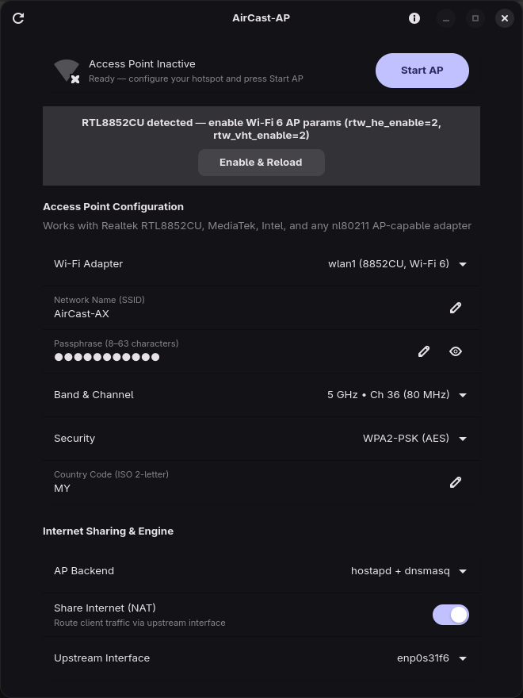
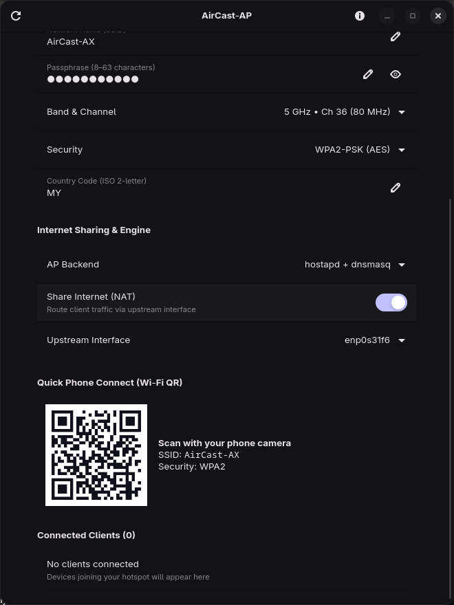

<div align="center">

# 📡 AirCast-AP

**Modern GTK4 + Libadwaita Wi-Fi 6 Access Point & Hotspot Manager for Linux**  
*Turn any AP-capable Linux Wi-Fi adapter (including Realtek RTL8852CU / RTL8832CU) into a fast 5 GHz Wi-Fi 6 / WPA3 hotspot with live QR sharing, NAT routing, and connected-client monitoring.*

[](#screenshots)
[](#features)
[](https://aur.archlinux.org/packages/aircast-ap)
[](https://aur.archlinux.org/packages/aircast-ap-git)
[](https://github.com/9M2PJU/rtl8852cu-9M2PJU-dkms)
[](LICENSE)

[🖼️ Screenshots](#-screenshots) •
[✨ Features](#-features) •
[🪄 Install](#-installation) •
[📚 Step-by-Step Tutorial](#-step-by-step-tutorial) •
[💻 CLI Reference](#-cli-reference) •
[☕ Support](#-support-this-project)

</div>

---

## 🖼️ Screenshots

<table>
  <tr>
    <td align="center" width="33%">
      <br/>
      <b>Main View &amp; RTL8852CU Auto-Detection</b><br/>
      <sub>Adapter detection, 1-click Wi-Fi 6 AP tuning banner, band/security/NAT controls</sub>
    </td>
    <td align="center" width="33%">
      <br/>
      <b>Live Active Access Point</b><br/>
      <sub>Live SSID/IP/channel banner with 1-click Stop AP &amp; clean client-mode restore</sub>
    </td>
    <td align="center" width="33%">
      <br/>
      <b>Wi-Fi QR &amp; Connected Clients</b><br/>
      <sub>Instant phone-camera QR code + live DHCP/RSSI/bitrate client list</sub>
    </td>
  </tr>
</table>

---

## ✨ Features

- 🎨 **Native GTK4 + Libadwaita UI** — Clean, lightweight Wayland/X11 desktop app (zero Electron bloat) with automatic dark/light theming and Polkit (`pkexec`) privilege prompts
- 📶 **Dual AP Backends:**
  - **`hostapd` + `dnsmasq` + `nftables`/`iptables` NAT** — Full **Wi-Fi 6 (802.11ax)**, **5 GHz 80 MHz** (ch 36 / ch 149) & **2.4 GHz**, **WPA2-PSK**, **WPA2/WPA3 Mixed**, and **WPA3-SAE**
  - **NetworkManager (`nmcli`)** — Instant zero-config hotspot when `hostapd` isn't installed
- 📱 **Live Wi-Fi QR Code** — Scannable QR card in the GUI (and terminal `--qr` flag) that updates live as you edit SSID/passphrase
- 👥 **Connected Clients Monitor** — Live polling of connected devices (hostname, IP from DHCP leases, MAC address, RSSI signal, TX bitrate)
- ⚡ **Built-in Realtek `8852cu` Optimizer** — Automatically detects [`rtl8852cu-9M2PJU-dkms`](https://github.com/9M2PJU/rtl8852cu-9M2PJU-dkms) adapters and shows a 1-click **Enable & Reload** banner for `rtw_he_enable=2 rtw_vht_enable=2`
- 🧹 **Clean Teardown** — Stopping the AP removes temporary NAT rules, stops `hostapd`/`dnsmasq`, and cleanly restores your adapter to NetworkManager managed mode
- 💻 **Full CLI Included** — Control or script your hotspot headlessly over SSH (`aircast-ap start|stop|status|devices`)

---

## 🪄 Installation

### Option 1: Arch Linux / CachyOS via AUR (Recommended)

```bash
# Stable tagged release:
yay -S aircast-ap

# Or bleeding-edge git HEAD:
yay -S aircast-ap-git
```

### Option 2: Interactive 1-Line Installer (All Linux Distros)

Supports Arch/CachyOS, Debian/Ubuntu, Fedora, and installs dependencies, launcher (`~/.local/bin/aircast-ap`), and desktop app entry:

```bash
curl -fsSL https://raw.githubusercontent.com/9M2PJU/AirCast-AP/main/install.sh | bash
```

---

## 📚 Step-by-Step Tutorial

### 1. Check Your Wi-Fi Adapter's AP Support
Open **AirCast-AP** from your app launcher (or run `aircast-ap devices` in terminal). It automatically lists all wireless adapters and prioritizes **Wi-Fi 6 AP-capable** interfaces such as Realtek `8852cu`:

```bash
aircast-ap devices
# Example output:
# wlan1       driver=rtl8852cu       mac=f0:09:0d:c2:dd:98  ap=True  wifi6_ap=True
# wlan0       driver=iwlwifi         mac=c2:c3:a0:6b:fb:12  ap=True  wifi6_ap=False
```

### 2. (Realtek RTL8852CU Users) Enable Full Wi-Fi 6 AP Parameters
If you use [`rtl8852cu-9M2PJU-dkms`](https://github.com/9M2PJU/rtl8852cu-9M2PJU-dkms), Realtek's driver defaults `rtw_he_enable=1` (STA only). AirCast-AP automatically displays a top banner — just click **Enable & Reload** (or run `sudo aircast-ap tune-8852cu`) to set `rtw_he_enable=2 rtw_vht_enable=2` in `/etc/modprobe.d/8852cu.conf` and reload the driver.

### 3. Configure Your Hotspot
1. **Wi-Fi Adapter:** Pick the adapter broadcasting the hotspot (e.g., `wlan1 (8852CU, Wi-Fi 6)`).
2. **Network Name (SSID) & Passphrase:** Enter your SSID and an 8–63 character password.
3. **Band & Channel:**
   - `5 GHz • Ch 36 (80 MHz)` or `Ch 149 (80 MHz)` — fastest Wi-Fi 6 throughput
   - `2.4 GHz • Ch 6 (20 MHz)` — widest range & legacy IoT compatibility
4. **Security:** `WPA2-PSK (AES)` works with every phone/laptop; pick `WPA2 / WPA3 Mixed` or `WPA3-SAE Only` for modern devices.
5. **AP Backend:**
   - Choose **`hostapd + dnsmasq`** for full Wi-Fi 6 / 80 MHz / WPA3 control.
   - Choose **`NetworkManager (nmcli)`** if you want a quick hotspot without `hostapd`.
6. **Share Internet (NAT):** Toggle **ON** and choose your internet-connected upstream interface (e.g., Ethernet `enp0s31f6` or internal Wi-Fi `wlan0`) so hotspot clients get internet access.

### 4. Start & Connect Your Phone in 2 Seconds
Click **Start AP** (authenticate once with Polkit). The top card turns **LIVE**, and you can point any iOS/Android camera at the **Quick Phone Connect (Wi-Fi QR)** card to join instantly! Watch connected clients appear live in the **Connected Clients** list below.

### 5. Stop Cleanly
Click **Stop AP** (or run `sudo aircast-ap stop`). AirCast-AP shuts down `hostapd`/`dnsmasq`, removes the temporary `nftables`/`iptables` NAT rules, and hands your Wi-Fi interface cleanly back to NetworkManager in client mode.

---

## 💻 CLI Reference

```bash
# Launch GTK4 GUI
aircast-ap

# List Wi-Fi adapters & AP / Wi-Fi 6 capabilities
aircast-ap devices

# Start a 5 GHz Wi-Fi 6 AP on wlan1 sharing internet from wlan0 (+ terminal QR)
sudo aircast-ap start -i wlan1 -s "9M2PJU-AX" -p "mypassword123" -b 5g-low -u wlan0 --qr

# Start a quick NetworkManager hotspot on 2.4 GHz ch 6
sudo aircast-ap start -i wlan0 -s "QuickHotspot" -p "mypassword123" -b 2g -c 6 --backend nmcli

# Check active AP status & connected clients (add --json for scripting)
aircast-ap status

# Stop AP and restore interface to client mode
sudo aircast-ap stop

# Enable Realtek RTL8852CU Wi-Fi 6 AP parameters
sudo aircast-ap tune-8852cu
```

---

## 🔌 Companion Driver: Realtek RTL8852CU / RTL8832CU

AirCast-AP works with **any** `nl80211` AP-capable Linux Wi-Fi adapter (Realtek, MediaTek, Intel, Qualcomm) and pairs seamlessly with our Linux 7.3+ DKMS driver:

👉 **[9M2PJU/rtl8852cu-9M2PJU-dkms](https://github.com/9M2PJU/rtl8852cu-9M2PJU-dkms)** — Linux 5.15–7.3+ & Clang/LLVM (CachyOS) DKMS driver for Realtek RTL8832CU & RTL8852CU USB Wi-Fi 6/6E adapters.

---

## ☕ Support This Project

If **AirCast-AP** makes Linux Wi-Fi hotspot / AP sharing effortless for you, consider supporting **9M2PJU**'s open-source & amateur radio projects:

<div align="center">

[](https://github.com/sponsors/9M2PJU)
[](https://www.buymeacoffee.com/9m2pju)
[](https://www.paypal.com/paypalme/9M2PJU)
[](https://wise.com/pay/me/faizulz13)

</div>

---

## 📄 License

Licensed under the **GNU General Public License v3.0 or later** ([`LICENSE`](LICENSE)).  
*73 de 9M2PJU!* 📻
